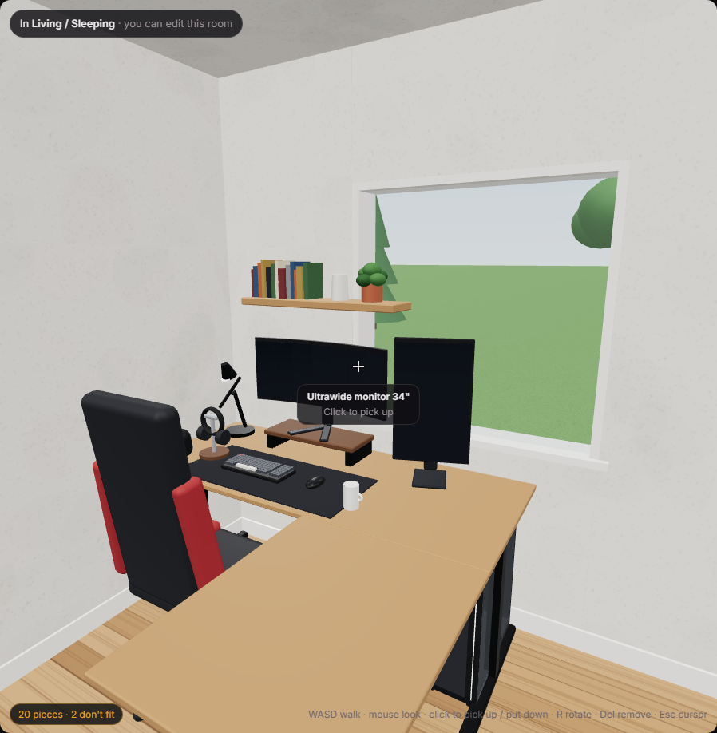
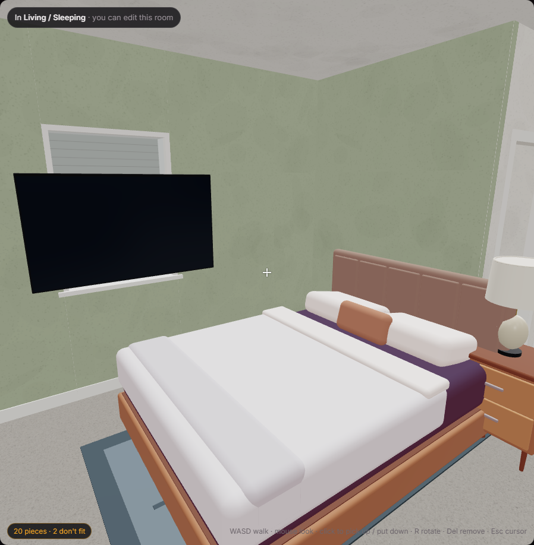

# Floorwise

A house-plan explorer for people who've never designed a house. Browse 31 original floor plans, from a 450 sq ft studio to a 3,200 sq ft two-story, including open great-room and live/work homes with a workshop. Drop in about 200 true-size pieces of furniture and see right away when a king bed blocks the closet door. Pieces have real heights, so a PC can go under a desk, a monitor on it and a shelf on the wall above. Then switch to **3D walk** to stand in the room at your own eye height and rearrange it from the inside. Along the way you learn *why* each plan is arranged the way it is.

**Live:** https://floorwise-seven.vercel.app (auto-deploys from `main`)

**Status:** v0.4 (November 2026).
- **v0.4:** the 3D view is now usable for real room design.
  - **Looks:** realistic code-built models for every piece, textured walls and floors, 9' ceilings, a neighbourhood outside the windows, door casings, window trim and baseboards.
  - **Controls:** steady mouse look and precise click-to-hold placement. Wall pieces drag up and down as well as sideways. Doors open and close with a click, and clicking the stairs takes you to the other floor.
  - **Finishes:** wall paint and floor type per room, plus a color choice for each piece.
- **v0.3:** a first-person 3D walk-through where you can edit the furniture in the room you're standing in, plus desk-level detail: vertical and wall-mounted monitors, risers, desk mats, keyboards, mice and the like, stacked in layers.
- **v0.2:** 12 more plans, the large catalog, and furniture heights.

Lighting is deliberately neutral; real lights are the next step, see [`docs/3D-PLAN.md`](docs/3D-PLAN.md). Plans are still fixed-size: you can't drag walls yet. Desktop browser is the target. The 3D view needs a mouse and keyboard; phones can browse plans but aren't polished.







## What you can do

- **Browse 31 plans** filtered by bedrooms, square footage and style (apartment, cottage, ranch, split-bedroom, open-concept, great room, live/work, L-shaped, courtyard, townhouse, two-story, narrow-lot, accessible). The great-room plans are deliberately unusual. One has a big open room plus a shop with a roll-up door. Another has a double-height living space under an upstairs loft. Others are a square house wrapped around a central plumbing core, a street-front studio with the home upstairs, and a two-wing pavilion.
- **Read the plan**: walls, door swings, windows, room names with dimensions and square footage, overall dimensions, a compass and a live scale bar. Pan with drag, zoom with the scroll wheel.
- **Click any room** to see its size, share of the house, privacy zone, which rooms it connects to (and by what kind of door), windows, and fixtures.
- **Place furniture** from a catalog of about 200 pieces at real sizes:
  - Beds: twin through California king, loft and bunk beds, a Murphy bed.
  - Desks: from compact to executive, standing, and L-desks.
  - Desk setups: landscape, vertical, triple and wall-mounted monitors, monitor risers, desk shelves, desk mats and mouse pads, full, tenkeyless and 60% keyboards, mice, PC towers (under or on the desk), laptops and stands, speakers, headphone stands, controllers, a stream deck, a mug, and a footrest.
  - Wall pieces: shelves, wall bookcases, posters, art, mirrors and wall TVs from 55" to 85".
  - Lighting: lamps, ceiling fans, pendants and LED strips.
  - Hobby, workshop and fitness: workbenches, pegboard, a table saw, a pool table, ping pong, an arcade cabinet, drum kits, a treadmill and a power rack.
  - Kitchen, bath and laundry fixtures.

  Drag a piece from the palette, or click it and it finds a sensible spot: against a wall, on a desk for monitors, under a desk for PC towers. Move, rotate (R, or drag the handle), duplicate, delete, undo.
- **Work in three dimensions on a flat plan.**
  - **Heights:** every piece has a height. Two pieces only collide when they overlap on the plan *and* in height.
  - **Surface pieces:** monitors, lamps and TVs on stands rest on whatever is under them and travel with it when you move it. It stacks more than one level deep: a keyboard on a desk mat on a desk, or a monitor on a riser on a desk. Move the desk and the whole stack comes along.
  - **Under-desk pieces:** PC towers and drawer pedestals go under a desk and move with it.
  - **Wall pieces:** they snap to the nearest wall, turn to face the room, and have an adjustable height.
  - **Chairs:** they tuck under desks and tables.
  - **On the plan:** pieces above about 4' are drawn dashed (the standard drafting convention), and anything hidden under something else shows as a dashed outline.
  - **Side view:** select any piece to see it next to a figure of your height (6'2" by default, adjustable).
- **Walk through it in 3D.** Press **3D walk** in the top bar. You start in the middle of the selected room (or the room in the middle of your view), at your eye height, which is your figure height minus 4.5".
  - **Moving:** walk with WASD (Shift to hurry) and look with the mouse, with an adjustable mouse speed. Walls and closed doors stop you.
  - **Steady look:** mouse look uses raw input where the browser supports it and ignores the bogus giant jumps some browsers report.
  - **No loading:** the whole floor is built at once, so going through a doorway never pauses.
  - **Stairs:** click them to go up or down; you arrive at the top or bottom of the flight. From upstairs you can look down the stairwell to the floor below.
  - **Doors:** click any door to open or close it (swing, double, sliding, pocket and garage doors all animate). Closed doors block you, and their state is remembered per floor.
  - **Editing:** only the room you're standing in. Aim at a piece and click to pick it up, then click to put it down.
    - The piece stays locked to the exact spot you grabbed it by.
    - Floor pieces slide across the floor, surface pieces across what they sit on, and wall pieces along the wall you're aiming at. Aim higher or lower to change a wall piece's height.
    - The held piece glows green, amber or red with the same fit checks as the plan, and anything sitting on it comes along.
    - R / Q / E rotate and Del removes.
  - **Other rooms** are fully drawn but locked. About half a second after you walk into a room, it becomes the editable one.
  - **Adding:** a piece added from the palette while in 3D lands in your current room and goes straight into your hands when you click back in.
  - **Fallback:** if the browser refuses mouse capture, it switches to drag-to-look.
  - **Finishes:** select a room (walking into one selects it) to choose its wall paint (presets or any color) and its floor (oak, walnut, carpet, tile, concrete). Select a piece to recolor it: the upholstery, the duvet on a bed, or the wood on a desk.
  - **Surroundings:** the street is on the front-door side, with neighbour houses and trees around, so windows show something and you can tell which way you're facing.
- **Browse the models:** the ⋯ menu opens a 3D gallery of every catalog piece with orbit controls, and every piece's inspector links to its own model.
- **See what doesn't fit.**
  - Red means a hard problem: the piece runs into a wall, overlaps something at the same height, blocks a door swing, or is a wall piece with no wall behind it.
  - Amber means a softer one: the piece crowds a doorway, covers a window, doesn't leave the recommended clearance (like 36" in front of a dresser), or is a monitor left on the floor.
  - Select a piece to see its clearance zone.
- **Learn as you go**: every plan has "why it's arranged this way" notes. A **Plan check** card runs 13 design rules on the plan, and **Zones** and **Flow** overlays show public/private grouping and the walking route from the front door. The **Learn** tab covers reading a plan, zoning, circulation, wet walls, the kitchen work triangle, light and orientation, a clearances cheat sheet, standard heights, common mistakes, and where to learn more.
- **Auto-furnish** gives a rough starter arrangement to rearrange. It is honestly rough: a greedy placer, not an interior designer.
- Furniture **saves in your browser** per plan, and can be exported or imported as JSON. Links like `?layout=classic-ranch-three&view=zones,flow` open a specific plan and view.

Keyboard: `R` / `Shift+R` rotate 90°, `Q` / `E` rotate 15°, arrows nudge 1" (Shift for 6"), `Del` remove, `Ctrl+D` duplicate, `Ctrl+Z` / `Ctrl+Shift+Z` undo/redo, `F` fit, `+`/`-` zoom, `Esc` deselect. Hold `Alt` while dragging to turn off wall snapping.

## Run it locally

```bash
npm install
npm run dev      # http://localhost:5340
npm test         # 554 tests
npm run build
```

## Adding your own layout

Layouts are plain TypeScript data in [`src/data/layouts/`](src/data/layouts). Every file there that default-exports a layout shows up in the library automatically. Units are **feet**, x grows east (right) and y grows south (down). Rooms are drawn to wall centerlines, so neighbors share an edge.

1. Copy [`studio-loft.ts`](src/data/layouts/studio-loft.ts) (or [`makers-barn.ts`](src/data/layouts/makers-barn.ts) for an open plan) to `my-house.ts` and change the `id`.
2. List rooms as rectangles `[x, y, width, depth]`. Use `rects: [...]` for L-shaped rooms. Room types include `great` (a combined living/dining/kitchen room), `workshop`, `studio`, and `open-below`, which is a double-height void on an upper floor and isn't counted in the area.
3. Connect rooms with doors. You don't give door coordinates: name the two rooms and the engine finds their shared wall.

```ts
rooms: [
  { id: 'living', name: 'Living', type: 'living', rect: [0, 0, 16, 14] },
  { id: 'hall', name: 'Hall', type: 'hall', rect: [16, 0, 4, 14] },
  { id: 'bed', name: 'Bedroom', type: 'bedroom', rect: [20, 0, 12, 12] },
  { id: 'closet', name: 'Closet', type: 'closet', rect: [20, 12, 12, 2] },
],
doors: [
  { between: ['living', 'outside'], side: 'S', main: true }, // front door, 3' wide by default
  { between: ['living', 'hall'], kind: 'open' },             // no wall at all
  { between: ['hall', 'bed'], at: 'start' },                 // 32" door near the north corner
  { between: ['bed', 'closet'], kind: 'bifold', width: 4 },
],
windows: [{ room: 'bed', side: 'E', width: 4 }],
fixtures: [{ item: 'toilet', room: 'bath', wall: 'N', at: 1 }], // back against the north wall, 1' from the corner
```

4. Run `npm test`. The suite runs every plan through the same checks as the Plan check card: no overlapping rooms, every door on a real shared wall, every room reachable from the front door, no bedroom you must walk through, no bathroom opening into the kitchen, bedrooms at least 70 sq ft with a closet and a window, 3' halls, doors that swing freely, fixtures out of doorways, wet rooms near each other, stairs that line up between floors, and a sensible kitchen work triangle. While the dev server runs, a red banner on the plan also tells you which line of data doesn't line up.

The full schema with comments is in [`src/engine/types.ts`](src/engine/types.ts).

## Adding furniture

Add one line to [`src/data/furniture/catalog.ts`](src/data/furniture/catalog.ts). Sizes are **inches**: `w` is side to side as you face it, `d` is back to front, `h` is height.

```ts
{ id: 'bed-daybed', name: 'Daybed', category: 'Beds', w: 41, d: 80, h: 32, symbol: 'bed', clearance: { front: 24 } },
```

`symbol` picks the top-down drawing in [`src/ui/symbols.tsx`](src/ui/symbols.tsx). The 3D model comes from the category files in [`src/ui/models/`](src/ui/models) (desk, bedroom, living, rest), which can match by symbol or by id; the helpers are in [`kit.ts`](src/ui/models/kit.ts). Check a model with `?gallery=1&focus=<id>`, or screenshot it with `scripts/shoot.sh` while the dev server runs. `clearance` (also inches) drives the amber "tight fit" hints. `flat: true` marks rugs and mats, which other furniture sits on.

Height options:

| Field | Meaning | Example |
|---|---|---|
| `h` | Overall height | desk `30`, bookshelf `72` |
| `clearUnder` | Open space underneath; things shorter than this fit under it | desk `26`, loft bed `56` |
| `mount: 'surface'` | Rests on whatever is under its center | monitors, lamps, a 3D printer |
| `mount: 'wall'` + `elev` | Hangs on a wall with its bottom edge `elev` inches up | shelf at `54`, poster at `42` |
| `mount: 'ceiling'` | Hangs from the 9' ceiling | fans, pendants |
| `tucks: true` | Can push in under anything with `clearUnder` | chairs, stools, benches |
| `under: true` | Belongs under a desk (auto-placement puts it there; it moves with the desk) | PC tower, drawer pedestal |
| `holds: true` | A surface piece other surface pieces can rest on | desk mat, mouse pad, monitor riser |
| `sitsOn` | Preferred surfaces for auto-placement, by symbol | `['desk', 'desk-l']` |
| `parts` | A non-rectangular footprint as rectangles `[x, y, w, d]` from the back-left corner | L-desks, sectionals |
| `flip: true` | Draw the symbol mirrored | the left-hand L-desk |

## How it works

- `src/engine/resolve.ts` turns layout data into geometry. It works out which wall segments are interior or exterior, cuts openings for doors, computes swing arcs as convex polygons, and places fixtures flush against inside wall faces.
- `src/engine/rules.ts` builds a graph of rooms connected by doors (and stairs between floors) and runs the design checks on it.
- `src/engine/furniture.ts` works out every piece's height (what rests on what) and then checks pieces against walls, door swings, doorway approach zones, windows, fixtures and each other. It uses separating-axis tests on rotated boxes plus a height-band overlap test. It also snaps pieces to walls, hangs wall pieces, carries what sits on a desk when the desk moves, and finds open spots.
- `src/engine/scene.ts` turns a floor into 3D boxes:
  - walls to a 9' ceiling, with headers over doors and window openings from 36" to 84" with glass, frames and sills
  - baseboards, and per-room paint skins on every wall face
  - door leaves with their open and closed angles, and stair flights
  - a collision test for walking
- `src/ui/` is React plus hand-built SVG for the plan. The 3D view ([`Walk3D.tsx`](src/ui/Walk3D.tsx)) uses three.js through React Three Fiber and loads only when you open it.
- **Models:** every 3D model is built in code from rounded boxes, cylinders, spheres and rings at the catalog's real size. There are no downloaded model files, so nothing has a licensing question and everything matches the fit checks exactly.
- **Textures:** wall, floor and ground textures are drawn on canvases at runtime (`src/ui/textures.ts`).
- **Reflections:** a soft environment map lets metal and screens read correctly. It isn't a light source.

## Verification

- **Automated (554 tests, Vitest):** every one of the 31 layouts passes all 13 design checks plus bed and bath counts. Geometry unit tests cover overlap, L-shaped outlines, interval math and rotated-box collisions. Resolver tests cover square-footage math, exterior wall length, open-plan edges and flush fixture placement. Negative tests confirm the checks catch overlapping rooms, a bath opening into a kitchen, a door between rooms that don't touch, an unreachable room, a fixture in a door swing, a window on an interior wall and a walk-through bedroom. Furniture tests cover standard mattress sizes, wall, overlap, door-swing and outside-the-house detection, rugs under furniture, tight-clearance warnings, wall snapping and auto-placement. Height tests cover:
  - a PC under a desk, a monitor resting on it, and a chair tucked under it
  - a shelf above a dresser that collides once it is lowered into the dresser
  - a wall piece with no wall behind it, and a poster covering a window
  - wall-mount snapping
  - what moves with a desk, and how riders follow its rotation
  - auto-placing a monitor on a desk and a tower under it
  - the free inside corner of an L-desk
  - the catalog's height data
  - **3D (v0.3):**
    - one glass pane per window, with a sill and a header
    - a header over every door
    - wall pieces built for every floor of every layout
    - standing allowed inside rooms but not in walls, outside, or on an open-to-below void
    - every catalog piece has a real-size model
    - a keyboard and mouse on a desk mat, and a monitor on a riser
    - the whole stack moving with the desk
    - a pushed-in chair passing under the desktop items
    - **v0.4:** wall paint splitting where a long wall passes several rooms
- **End-to-end (v0.4):** a headless-Chrome script with software WebGL drove the real 3D view. All 18 checks passed:
  - a held compact desk keeps its distance and follows a 25° turn
  - a wall shelf rises and lowers with the aim and slides sideways
  - a door toggles with a click
  - a closed door blocks walking, and an open one lets you through
  - clicking the stairs takes you upstairs to the top of the flight without re-clicking to walk, and the stairs lead back down

  Visual checks of finishes, models and textures were done from screenshots.
- **Checked by hand in a desktop browser:**
  - **v0.3:** I walked between rooms and watched edit permission switch.
    - I picked up a wall bookcase and slid it along the wall into a live "Covers a window" warning, then put it down. The undo step and the saved position were correct.
    - A piece added from the palette went straight into my hands.
    - A full desk setup rendered correctly in 3D, and plan mode still works.
    - The test browser refuses pointer lock, so walking was checked in the drag-to-look fallback. Normal mouse capture is standard browser behaviour, but I haven't seen it run in your browser.
  - **v0.2:** all 12 new layouts render with starter furniture, and the open-to-below upper floor draws correctly. I checked by hand that a monitor and a PC move with a dragged L-desk, a monitor auto-places onto a desk, and a poster snaps to a wall. The side view and wall-height control update the fit warning live, with no console errors.
  - **v0.1:** every layout loads and renders with no console errors or data warnings, including both floors of the two-story plans. Placing, dragging, rotating, undoing and deleting furniture work. Fit warnings fire for walls and door swings. The Zones and Flow overlays, room details, auto-furnish and furniture persistence after reload all work. Phone width was viewed briefly: plans browse fine, but the panels become drawers and it isn't tuned.
- **Not tested:** touch gestures such as pinch-zoom (not implemented), Safari and Firefox, very large custom layouts, and real users.

## Known limitations

- Plans are fixed-size: no wall editing or resizing yet.
- Dimensions are to wall centerlines, a simplification. Real interior clear sizes are a few inches smaller. Furniture *does* respect wall thickness.
- Apartment plans treat every outside edge as an exterior wall. There's no shared corridor or neighbor unit.
- The design checks are teaching heuristics, not building code review. The plumbing check only asks that each wet room has another within 10', or stacked above or below. Bath fixture clearances and kitchen aisle widths are set by hand in each plan and aren't checked.
- Auto-furnish is greedy and doesn't know that a sofa should face the TV. It also tends to drop a dining table in the middle of a great room, right under the room label.
- Heights use one flat 9' ceiling, and windows are assumed to run from 36" to 84". The double-height rooms under `open-below` are not modeled as taller.
- An `open-below` void counts as walkable floor in the circulation graph. That's harmless for the checks, but not literally true.
- A kitchen drawn inside a `great` room (as in Gallery Long House) isn't covered by the plumbing check, which only looks at `kitchen` rooms.
- **3D view:**
  - Lighting is neutral, with no lamps, sunlight or shadows yet.
  - Models are code-built mockups, not photoreal products.
  - You walk through furniture; only walls and closed doors block you.
  - Double-height rooms get a normal 9' ceiling.
  - Stairs teleport you rather than letting you climb them.
  - Mouse look hasn't been checked in your own browser yet (the test browser can't capture the mouse). Tell me if the view still jumps.
  - Finishes aren't shown in the 2D plan.
- No printing.

## Story

Zach wanted a home-planning tool he could tinker with directly: pick from lots of plans at different square footages, drop in a bed of any size, and gradually learn how rooms chain together beyond the obvious ones like closets and en-suite baths. He's new to residential design. So the app explains the reasoning behind each plan, which rules make a layout work, and what to read or watch next. Layouts and furniture are deliberately plain data files so he, or anyone, can add their own.

## AI assistance and Zach's role

This was built almost entirely by AI. Claude Code (Anthropic's Claude Opus 5.5) wrote all the code, all 31 floor plans, the furniture catalog, the design notes and learning text, and the tests.
- **v0.1:** four parallel Claude agents drafted 18 of the 19 plans.
- **v0.2:** three more agents drafted the 12 new plans.
- **v0.3:** the 3D view and its models were written by the main agent.
- **v0.4:** four parallel agents rebuilt the models (desk/tech, bedroom, living, everything else), each checking its work with headless screenshots. The main agent built the controls, doors, stairs, textures, surroundings and finishes, and ran an independent review agent over the 3D code.
- The main agent reviewed every plan visually and through the automated checks, and wrote the engine, UI and catalog itself.

Zach came up with the idea and set the direction: a built-out interface first, many preset layouts across square footages, true-size furniture, data files he can edit himself, learning help, and open source.
- After using v0.1, he asked for:
  - more plans in the 1,000-2,500 sq ft range, at least five of them unconventional open layouts suitable for a workshop or office
  - a much bigger catalog focused on bedrooms, offices and living rooms
  - a way to stack furniture, such as a PC under a desk or a shelf above a dresser
  - a plan for a 3D walk-through
- After v0.2, he asked for the walk-through and 3D editing in one pass:
  - one first-person character spawning mid-room
  - seamless room transitions
  - editing limited to the current room
  - neutral lighting for now
  - lots of desk detail (vertical and wall monitors, mouse pad, mouse, keyboard, PC tower) with proper layering
- After v0.3, he reported that the view jumped and that held pieces drifted. He asked for:
  - height dragging for wall pieces
  - clickable doors and stairs
  - more realistic models
  - a taller ceiling
  - wall texture
  - something outside the windows

  Room finishes and item colors were the AI's addition.
- He allowed any downloadable models, preferring free ones. Building simple models in code was the AI's choice.
- The height system design (bands, surface/wall/ceiling mounts, the side view) was left to the AI's judgment.
- Routine technical and design choices were delegated to the AI.

The floor plans are original. They follow general residential conventions and were not copied from any published plan.

## Attribution

- Fonts: [Inter](https://github.com/rsms/inter) and [Unbounded](https://github.com/googlefonts/unbounded), both under the SIL Open Font License 1.1, bundled via Fontsource.
- Icons, furniture drawings and 3D furniture models are original, made in code for this project.
- Built with React, Vite, TypeScript, Vitest, three.js and React Three Fiber (all MIT).

## License

None yet. All rights reserved; the source is public to read.
