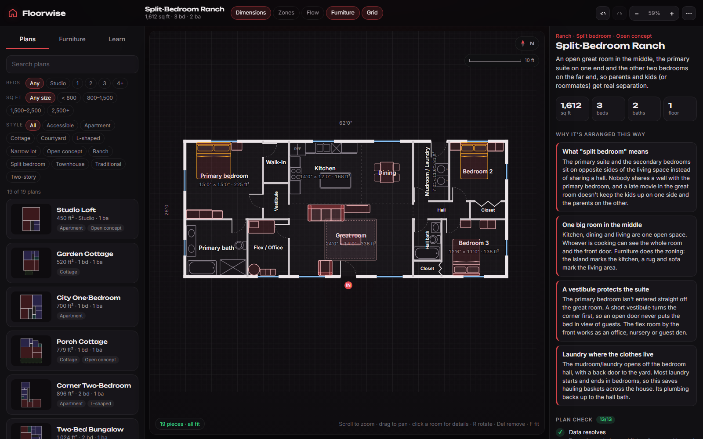
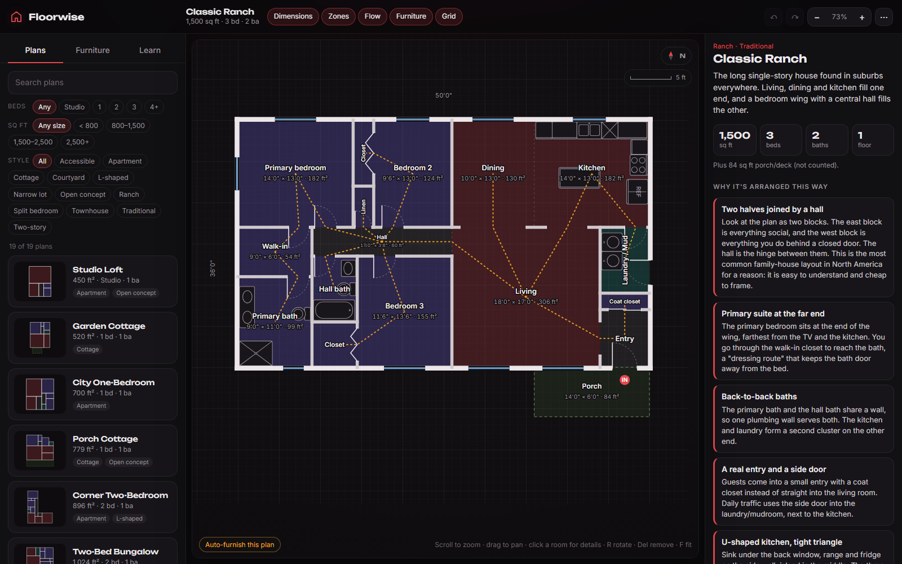

# Floorwise

A house-plan explorer for people who've never designed a house. Browse 19 original floor plans from a 450 sq ft studio to a 3,200 sq ft two-story. Drop true-size furniture into them and see right away when a king bed blocks the closet door. Along the way you learn *why* each plan is arranged the way it is.

**Live:** https://floorwise-seven.vercel.app (auto-deploys from `main`)

**Status:** First working version (v0.1, October 2026). The plan viewer, layout library, furniture placement with fit checks, and the learning notes all work. Plans are fixed-size for now: you can't drag walls yet. Desktop browser is the target; phones can browse plans but aren't polished.





## What you can do

- **Browse 19 plans** filtered by bedrooms, square footage and style (apartment, cottage, ranch, split-bedroom, open-concept, L-shaped, courtyard, townhouse, two-story, narrow-lot, accessible).
- **Read the plan**: walls, door swings, windows, room names with dimensions and square footage, overall dimensions, a compass and a live scale bar. Pan with drag, zoom with the scroll wheel.
- **Click any room** to see its size, share of the house, privacy zone, which rooms it connects to (and by what kind of door), windows, and fixtures.
- **Place furniture** from a catalog of about 60 pieces at real sizes: twin through California king beds, sofas, sectionals, dining sets, desks, dressers, kitchen appliances, toilets, tubs, showers, washers and more. Drag it from the palette, or click and it finds a clear spot against a wall. Move, rotate (R, or drag the handle), duplicate, delete, undo.
- **See what doesn't fit.** Pieces turn red when they run into a wall, overlap something, or block a door swing. They turn amber when they crowd a doorway or don't leave the recommended clearance, like 36" in front of a dresser or 24" beside a bed. Select a piece to see its clearance zone.
- **Learn as you go**: every plan has "why it's arranged this way" notes. A **Plan check** card runs 13 design rules on the plan, and **Zones** and **Flow** overlays show public/private grouping and the walking route from the front door. The **Learn** tab covers reading a plan, zoning, circulation, wet walls, the kitchen work triangle, light and orientation, a clearances cheat sheet, common mistakes, and where to learn more.
- **Auto-furnish** gives a rough starter arrangement to rearrange. It is honestly rough: a greedy placer, not an interior designer.
- Furniture **saves in your browser** per plan, and can be exported or imported as JSON. Links like `?layout=classic-ranch-three&view=zones,flow` open a specific plan and view.

Keyboard: `R` / `Shift+R` rotate 90°, `Q` / `E` rotate 15°, arrows nudge 1" (Shift for 6"), `Del` remove, `Ctrl+D` duplicate, `Ctrl+Z` / `Ctrl+Shift+Z` undo/redo, `F` fit, `+`/`-` zoom, `Esc` deselect. Hold `Alt` while dragging to turn off wall snapping.

## Run it locally

```bash
npm install
npm run dev      # http://localhost:5340
npm test         # 333 tests
npm run build
```

## Adding your own layout

Layouts are plain TypeScript data in [`src/data/layouts/`](src/data/layouts). Every file there that default-exports a layout shows up in the library automatically. Units are **feet**, x grows east (right) and y grows south (down). Rooms are drawn to wall centerlines, so neighbors share an edge.

1. Copy [`studio-loft.ts`](src/data/layouts/studio-loft.ts) to `my-house.ts` and change the `id`.
2. List rooms as rectangles `[x, y, width, depth]`. Use `rects: [...]` for L-shaped rooms.
3. Connect rooms with doors. You don't give door coordinates: name the two rooms and the engine finds their shared wall.

```ts
rooms: [
  { id: 'living', name: 'Living', type: 'living', rect: [0, 0, 16, 14] },
  { id: 'hall', name: 'Hall', type: 'hall', rect: [16, 0, 4, 14] },
  { id: 'bed', name: 'Bedroom', type: 'bedroom', rect: [20, 0, 12, 12] },
  { id: 'closet', name: 'Closet', type: 'closet', rect: [20, 12, 12, 2] },
],
doors: [
  { between: ['living', 'outside'], side: 'S', main: true }, // front door, 3' wide by default
  { between: ['living', 'hall'], kind: 'open' },             // no wall at all
  { between: ['hall', 'bed'], at: 'start' },                 // 32" door near the north corner
  { between: ['bed', 'closet'], kind: 'bifold', width: 4 },
],
windows: [{ room: 'bed', side: 'E', width: 4 }],
fixtures: [{ item: 'toilet', room: 'bath', wall: 'N', at: 1 }], // back against the north wall, 1' from the corner
```

4. Run `npm test`. The suite runs every plan through the same checks as the Plan check card: no overlapping rooms, every door on a real shared wall, every room reachable from the front door, no bedroom you must walk through, no bathroom opening into the kitchen, bedrooms at least 70 sq ft with a closet and a window, 3' halls, doors that swing freely, fixtures out of doorways, wet rooms near each other, stairs that line up between floors, and a sensible kitchen work triangle. While the dev server runs, a red banner on the plan also tells you which line of data doesn't line up.

The full schema with comments is in [`src/engine/types.ts`](src/engine/types.ts).

## Adding furniture

Add one line to [`src/data/furniture/catalog.ts`](src/data/furniture/catalog.ts). Sizes are **inches**: `w` is side to side as you face it, `d` is back to front.

```ts
{ id: 'bed-daybed', name: 'Daybed', category: 'Beds', w: 41, d: 80, symbol: 'bed', clearance: { front: 24 } },
```

`symbol` picks the top-down drawing in [`src/ui/symbols.tsx`](src/ui/symbols.tsx). Reuse one, or add a new case there. `clearance` (also inches) drives the amber "tight fit" hints. `flat: true` marks rugs, which other furniture can sit on.

## How it works

- `src/engine/resolve.ts` turns layout data into geometry. It works out which wall segments are interior or exterior, cuts openings for doors, computes swing arcs as convex polygons, and places fixtures flush against inside wall faces.
- `src/engine/rules.ts` builds a graph of rooms connected by doors (and stairs between floors) and runs the design checks on it.
- `src/engine/furniture.ts` checks placed pieces against walls, door swings, doorway approach zones, fixtures and each other, using separating-axis tests on rotated boxes. It also snaps pieces to walls and finds open spots.
- `src/ui/` is React plus hand-built SVG, with no UI or canvas library. Floor plans render in feet, with screen-constant line widths.

## Verification

- **Automated (333 tests, Vitest):** every one of the 19 layouts passes all 13 design checks plus bed and bath counts. Geometry unit tests cover overlap, L-shaped outlines, interval math and rotated-box collisions. Resolver tests cover square-footage math, exterior wall length, open-plan edges and flush fixture placement. Negative tests confirm the checks catch overlapping rooms, a bath opening into a kitchen, a door between rooms that don't touch, an unreachable room, a fixture in a door swing, a window on an interior wall and a walk-through bedroom. Furniture tests cover standard mattress sizes, wall, overlap, door-swing and outside-the-house detection, rugs under furniture, tight-clearance warnings, wall snapping and auto-placement.
- **Checked by hand in a desktop browser:** every layout loads and renders with no console errors or data warnings, including both floors of the two-story plans. Placing, dragging, rotating, undoing and deleting furniture work. Fit warnings fire for walls and door swings. The Zones and Flow overlays, room details, auto-furnish and furniture persistence after reload all work. Phone width was viewed briefly: plans browse fine, but the panels become drawers and it isn't tuned.
- **Not tested:** touch gestures such as pinch-zoom (not implemented), Safari and Firefox, very large custom layouts, and real users.

## Known limitations

- Plans are fixed-size: no wall editing or resizing yet.
- Dimensions are to wall centerlines, a simplification. Real interior clear sizes are a few inches smaller. Furniture *does* respect wall thickness.
- Apartment plans treat every outside edge as an exterior wall. There's no shared corridor or neighbor unit.
- The design checks are teaching heuristics, not building code review. The plumbing check only asks that each wet room has another within 10', or stacked above or below. Bath fixture clearances and kitchen aisle widths are set by hand in each plan and aren't checked.
- Auto-furnish is greedy and doesn't know that a sofa should face the TV.
- No 3D view, no decor or materials, no printing.

## Story

Zach wanted a home-planning tool he could tinker with directly: pick from lots of plans at different square footages, drop in a bed of any size, and gradually learn how rooms chain together beyond the obvious ones like closets and en-suite baths. He's new to residential design. So the app explains the reasoning behind each plan, which rules make a layout work, and what to read or watch next. Layouts and furniture are deliberately plain data files so he, or anyone, can add their own.

## AI assistance and Zach's role

This was built almost entirely by AI. Claude Code (Anthropic's Claude Opus 5.5) wrote all the code, all 19 floor plans, the furniture catalog, the design notes and learning text, and the tests. Four parallel Claude agents drafted the plans; the main agent reviewed each one visually and through the automated checks.

Zach came up with the idea and set the direction: a built-out interface first, many preset layouts across square footages, true-size furniture, data files he can edit himself, learning help, and open source. Routine technical and design choices were delegated to the AI. At first publish, Zach had not yet reviewed or used the app; that review is the next step.

The floor plans are original. They follow general residential conventions and were not copied from any published plan.

## Attribution

- Fonts: [Inter](https://github.com/rsms/inter) and [Unbounded](https://github.com/googlefonts/unbounded), both under the SIL Open Font License 1.1, bundled via Fontsource.
- Icons and furniture drawings are original SVG made for this project.
- Built with React, Vite, TypeScript and Vitest (MIT).

## License

None yet. All rights reserved; the source is public to read.
